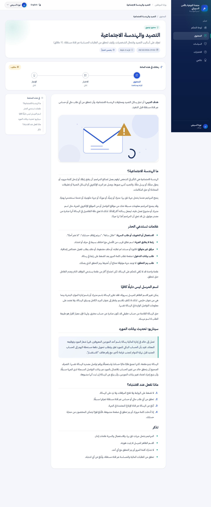
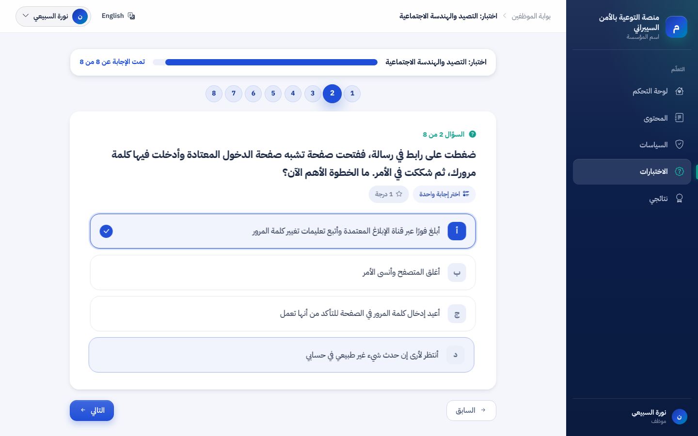
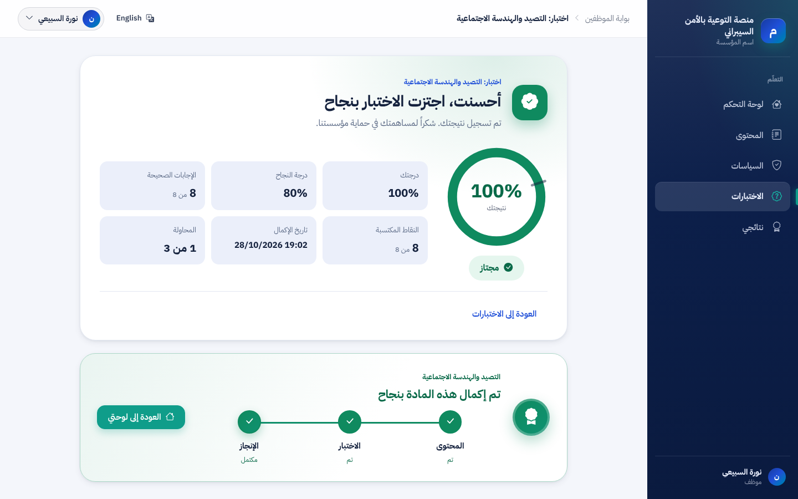
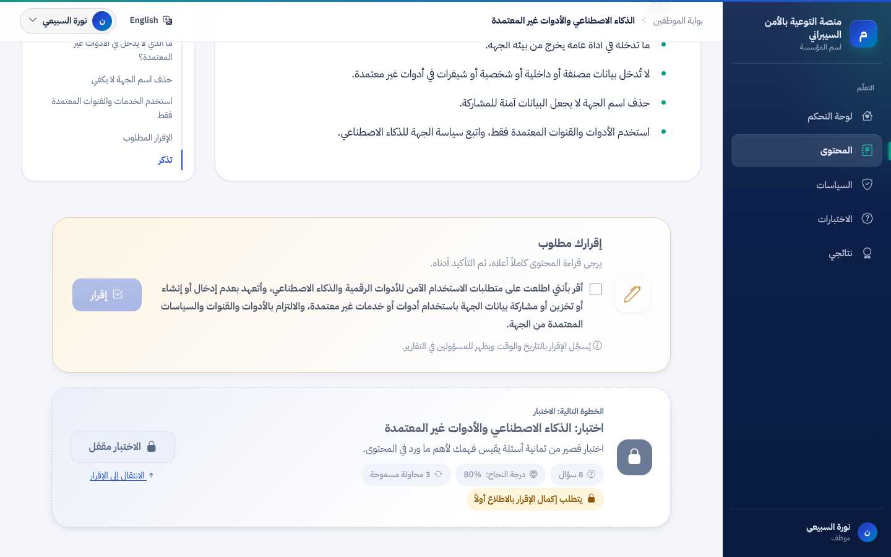
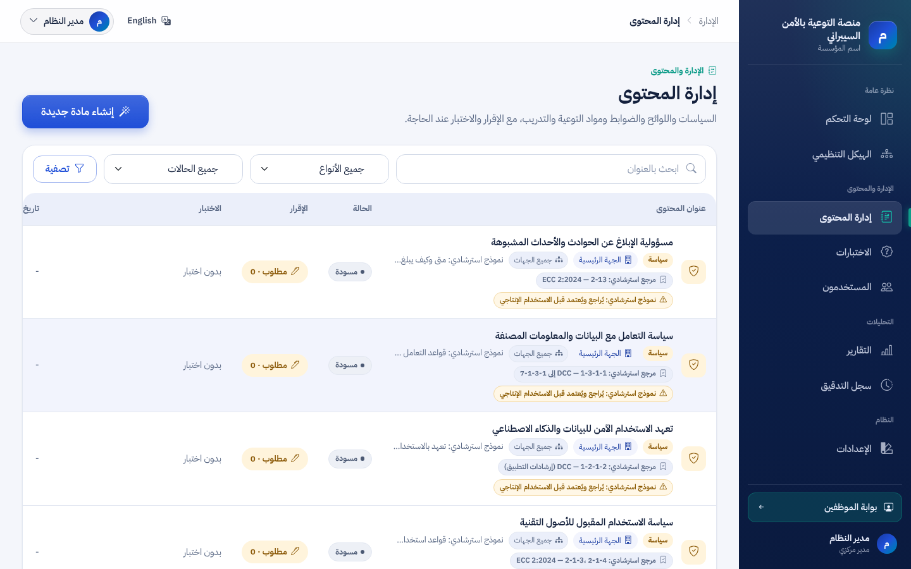
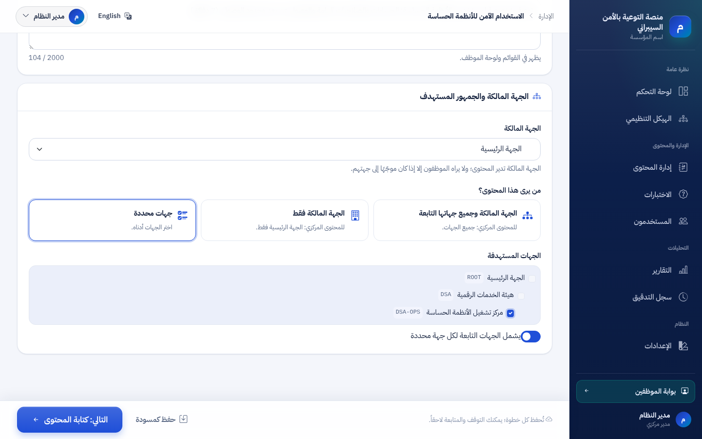
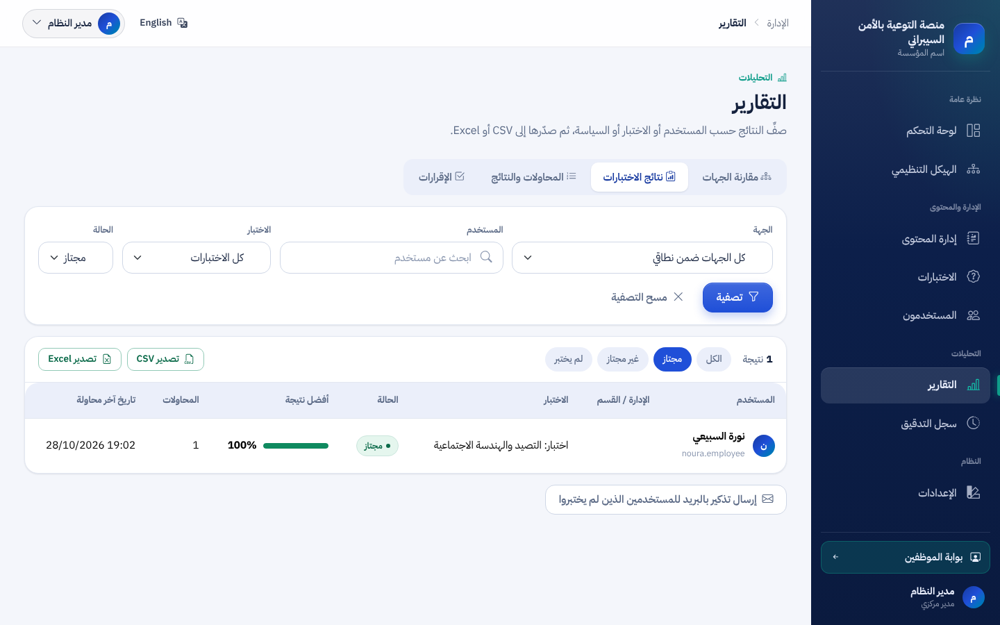

# Starter content pack v1: screenshots
Fresh Development database, pack installed with `--install-starter-pack`, everything else through the UI (`tools/starter-pack/run-acceptance.sh`, 28/28 checks). See [STARTER_CONTENT_PACK.md](../../STARTER_CONTENT_PACK.md).

## 01-employee-dashboard
لوحة الموظف: محتوى الحزمة الأولية موزع على جميع الجهات (موظفة في جهة تابعة)

## 02-phishing-lesson
درس «التصيد والهندسة الاجتماعية»: هدف الدرس ورسم توضيحي محلي وأقسام قصيرة

## 02b-phishing-lesson-full
درس التصيد كاملًا

## 03-assessment
اختبار درس التصيد: ثمانية أسئلة سلوكية بخيارات عربية

## 03b-assessment-result
نتيجة الاختبار ومراجعة الإجابات

## 04-ai-acknowledgment-gate
درس الذكاء الاصطناعي: الإقرار الإلزامي قبل فتح الاختبار (نص الإقرار نموذج استرشادي يُراجع قبل الإنتاج)

## 05-policy-template
نموذج سياسة (مسودة) في المعاينة: شريط «نموذج استرشادي تجريبي» في البداية وإقرار إلزامي

## 06-admin-content-list
قائمة إدارة المحتوى للمدير المركزي: 16 عنصرًا من الحزمة الأولية مع المرجع الاسترشادي وحالة النشر والجمهور

## 07-entity-targeting
مثال استهداف: المدير المركزي يوجّه SPC-001 إلى «مركز تشغيل الأنظمة الحساسة» فقط

## 08-report
تقرير الاختبارات: نتيجة الموظفة في اختبار درس التصيد (نجاح)

